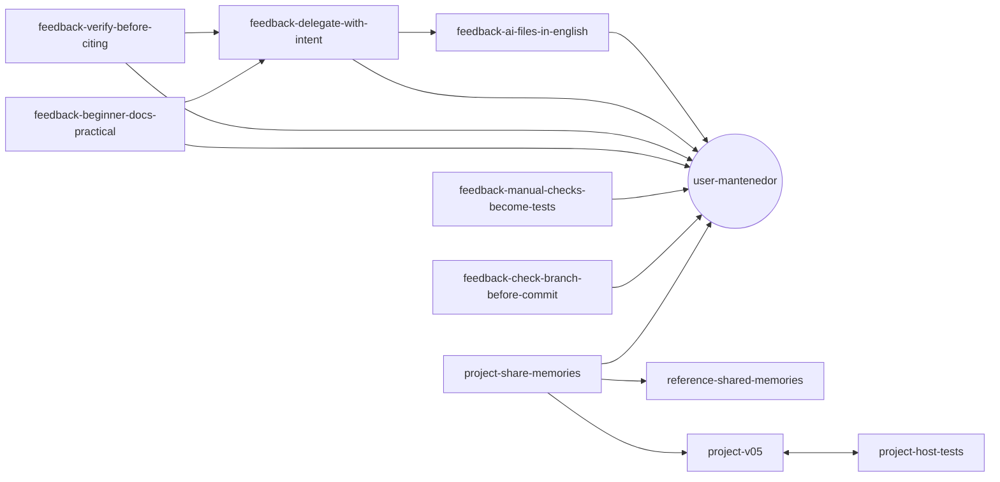

# Memórias que se conectam: estamos indo para as sinapses?

> **Artigo especulativo.** Ele separa três coisas: o que a documentação
> oficial diz, o que já dá para ver nos arquivos, e o que é aposta. A
> aposta está marcada como aposta.

Quem usa Obsidian conhece o *graph view*: cada nota é um ponto, cada
`[[link]]` é uma linha, e com o tempo surgem aglomerados, notas centrais e
notas soltas. A pergunta deste artigo é se a memória do Claude Code está
indo para algo assim, ou além disso: memórias que se ligam, se reforçam e
se apagam como sinapses no cérebro.

## O que existe hoje (documentado)

Pela [documentação oficial de memória](https://code.claude.com/docs/en/memory)
(conferido em outubro/2026, Claude Code 2.1.310), a memória automática é
uma pasta de arquivos Markdown por projeto:

| Peça | Como funciona |
|---|---|
| `MEMORY.md` | Índice, uma linha por memória. Carrega em toda conversa (primeiras 200 linhas ou 25 KB) |
| Um arquivo por memória | Lido **sob demanda**, quando o Claude acha que precisa |
| Tipo no frontmatter | `user`, `feedback`, `project` ou `reference` |
| Campo `modified` | O Claude Code grava a data da última escrita, para saber se o fato está velho |
| Limite do índice | Perto de 200 linhas, o Claude Code pede para juntar ou apagar entradas antigas |

Detalhes de onde isso fica no container: [Memória e instruções](./memoria-e-instrucoes.md).

Até aqui, é uma lista com um índice. Nada de rede.

## O que já dá para ver (e a documentação não conta)

A instrução que o Claude Code envia ao modelo sobre memória (vista numa
sessão de outubro/2026, Claude Code 2.1.310; a página oficial não fala
disso, então pode mudar sem aviso) pede uma coisa a mais: **ligar as memórias entre si
com `[[nome]]`**, "à vontade". E diz que um link para uma memória que
ainda não existe não é erro: marca algo que vale escrever depois.

Isso é exatamente o link não resolvido do Obsidian.

E não ficou só na instrução. As 11 memórias do próprio dev-sandbox já têm
14 links entre si (situação de 28/10/2026):



Repare no que apareceu sozinho, sem ninguém planejar:

- **Um centro.** `user-mantenedor` (quem é o usuário) recebe 7 dos 14
  links. Faz sentido: quase toda regra de trabalho existe *por causa* de
  quem pede.
- **Um par.** `project-v05` e `project-host-tests` apontam um para o
  outro: são o mesmo assunto visto de dois lados.
- **Uma cadeia.** `beginner-docs-practical` → `delegate-with-intent` →
  `ai-files-in-english`: cada preferência se apoia na anterior.

Ou seja: o grafo já existe. Só ninguém está olhando para ele.

### Ver o grafo hoje, no Obsidian

Como são arquivos `.md` comuns com `[[links]]`, dá para abrir a pasta de
memória como um *vault* do Obsidian e ver o graph view agora:

1. No **host**, copie a pasta de memória do projeto para outro lugar
   (copiar evita que a pasta `.obsidian/` do Obsidian fique lá dentro, no
   meio das memórias). Onde ela fica no host depende de como o dev-sandbox
   monta o `$HOME`: veja [Memória e instruções](./memoria-e-instrucoes.md).

   ```bash
   cp -r <pasta-de-memoria-do-projeto> ~/memorias-grafo
   ```

2. No Obsidian: **Open folder as vault** → escolha a cópia.
3. Abra o **Graph view** (`Ctrl+G`).

Funciona porque aqui o `name:` de cada memória é igual ao nome do arquivo
(`user-mantenedor` ↔ `user-mantenedor.md`). Se um dia forem diferentes, o
Obsidian mostra o link como não resolvido.

## A analogia: o que é sinapse aqui

| No cérebro | Na memória do Claude Code | Já existe? |
|---|---|---|
| Neurônio | Um arquivo de memória | Sim |
| Sinapse | Um `[[link]]` | Sim, desde que o modelo escreva |
| Força da sinapse | Quantas vezes o link foi útil | **Não.** Todo link vale o mesmo |
| "Disparam juntos, ligam juntos" (Hebb) | Memórias lembradas juntas ganham um link | **Não.** O link é escrito ao salvar, não ao usar |
| Esquecer o que não se usa | Apagar memórias velhas | **Em parte.** O limite do índice força a poda |
| Ativação em cadeia | Lembrar A traz os vizinhos de A | **Não sozinho.** O Claude só segue um link se decidir abrir o arquivo |
| Sono / consolidação | Reorganizar memórias fora da conversa | **Não**, que eu saiba |

Hoje é um **grafo**, não um cérebro. Um grafo é desenhado; uma rede de
sinapses se desenha sozinha com o uso. Nada "dispara" na memória do Claude
Code: é o modelo que lê o índice, escolhe um arquivo, e talvez siga um
link.

## Especulação: o que faltaria para virar sinapse

> Daqui em diante é aposta. Nada disto foi anunciado.

**1. Peso nos links.** Contar quantas vezes duas memórias foram lidas na
mesma conversa e foram úteis. O campo `modified` já é um primeiro sinal de
tempo; um campo de uso seria o primeiro sinal de força.

**2. Poda pelo desuso.** Hoje a poda acontece porque o índice enche (200
linhas). Num modelo de sinapse, a poda viria pelo desuso: memória que
ninguém lê há meses enfraquece, vira candidata a juntar ou sair.
Curiosamente, o limite atual já empurra para isso, só que por espaço, não
por uso.

**3. Ativação em cadeia.** Ao lembrar `project-v05`, trazer junto o
resumo de `project-testes-no-host`, porque estão ligados. Hoje isso
depende do modelo decidir abrir o segundo arquivo.

**4. Consolidação "no sono".** Um processo entre conversas que relê as
memórias, encontra duplicatas, cria links que faltam e resolve
contradições. É o que o cérebro faz dormindo. Dá para imitar hoje com um
hook ou uma rotina agendada (`/schedule`), mas não é nativo.

**5. Ligações entre projetos.** Cada projeto tem sua própria pasta de
memória: um "cérebro" por projeto. A skill
[`/share-memories`](./compartilhar-memorias.md) deste repositório já liga
memórias entre projetos com links simbólicos. Na metáfora, é o feixe de
fibras que conecta dois hemisférios. O próximo passo seria um link
`[[outro-projeto/memoria]]` que atravessa pastas.

## Os riscos (que o cérebro também tem)

- **Falsa memória que vira centro.** Se uma memória errada recebe muitos
  links, ela passa a parecer importante e é lida mais vezes. Reforço sem
  conferência fixa o erro. No cérebro isso tem nome: memória falsa.
- **Links que não dizem nada.** "Ligar à vontade" pode virar ligar tudo
  com tudo. Um grafo onde tudo se conecta é tão inútil quanto um sem
  links.
- **Perder a leitura humana.** A maior virtude da memória atual é que
  você abre um `.md` e entende. Pesos, contadores e ativações automáticas
  são difíceis de auditar. Sinapse ninguém lê.

## Contraponto: talvez não vá por aí

Outro caminho possível: janelas de contexto cada vez maiores e busca
melhor tornariam o grafo desnecessário. Para que seguir links se dá para
carregar tudo, ou buscar por significado?

Minha aposta é um meio-termo: **o grafo continua em Markdown, legível,
e a "biologia" fica em volta dele.** Os links continuam sendo
`[[nome]]` que você vê no Obsidian; o peso, a poda e a consolidação viram
processos que propõem mudanças nesses arquivos, e você (ou o Claude)
revisa como revisa um commit. Sinapse, mas com `git diff`.

## Resumo

| Pergunta | Resposta |
|---|---|
| A memória do Claude Code é um grafo? | Já é, em potencial: o modelo é instruído a ligar memórias com `[[nome]]`, e neste projeto já ligou |
| É uma rede de sinapses? | Não. Links não têm peso, não nascem do uso, não disparam sozinhos |
| Dá para ver o grafo? | Sim: copie a pasta de memória e abra como vault do Obsidian |
| Vai virar sinapse? | Especulação: peso, poda por desuso, ativação em cadeia e consolidação são os passos que faltam |
| O que perderíamos? | A capacidade de abrir um arquivo e entender o que o Claude lembra |

Relacionados: [Memória e instruções](./memoria-e-instrucoes.md),
[Compartilhar memórias](./compartilhar-memorias.md),
[Por baixo dos panos](./por-baixo-dos-panos/README.md).
